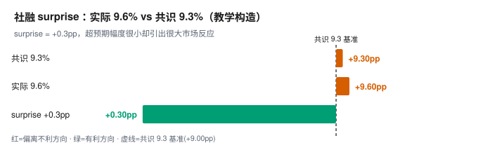

<!-- PART1:CONCLUSION -->

# 解读卡 · 金融领域教学案例（2 例 · 教学构造）

> 双层契约 v2.3：本文件为 **Part 1 结论层**｜分析过程 → [附录（七步 SOP 全量 · §A–§K）](./finance_appendix.md)｜快读版（30 秒） → [快读卡](./finance_brief.md)
> 🚨 **教学构造声明**：本卡全部数值为**虚构教学场景**，标注【示例·非真实】；所有 `T` 级信源标记均为**占位演示**，**不代表任何真实发布方**，不可用于任何真实决策。

| 项 | 值 |
|---|---|
| **指标** | 社会融资规模存量同比 / M1、M2 及剪刀差（两个虚构场景） |
| **读数** | 场景 1：社融存量同比 **9.6%**，市场共识 **9.3%** → surprise **+0.3pp**；公布后当日**权益下跌、债券走强**。场景 2：1 月 M1 同比 **+5.0%**、M2 **+8.0%**（剪刀差 −3.0pp）；2 月 M1 **−1.0%**、M2 **+8.5%**（剪刀差 −9.5pp）【示例·非真实】 |
| **时期 / 口径** | 月度 · **存量同比**（社融、M1、M2 均为**存量**指标）· 同比**未季调** · **名义**（未剔价格，金融量一般不谈实际值） |
| **发布方 / 时点 / 来源** | 教学构造 · as-of **2026-10-04** · 虚构，无真实发布方与真实来源 |
| **L2 语义** | 存量（社融、M1、M2）/ 名义 / 月度时间框架 / 信用扩张**内生**，央行操作与监管口径**外生** |
| **一句话结论** | 场景 1 的"社融超预期但股市跌"**不是市场犯错**，是**总量 surprise 与质量 surprise 不同号**——市场只对偏离定价，且偏离里的"结构"才是被定价的东西。场景 2 的"剪刀差从 −3.0 暴走到 −9.5"**第一件事是查是不是春节错位**，1—2 月单月剪刀差在方法上不可用。本卡不含预测与投资建议。 |
| **下一步看什么** | 教学构造无真实下期；真实调用时看 9月社融与 M1−M2 剪刀差是否继续走阔 |

## 案例 1 · 社融超预期，股市却下跌

- **场景**：某月社融存量同比 9.6%，市场共识 9.3%，实际超预期 +0.3pp；数据公布后当日权益市场下跌、债券走强。【示例·非真实】
- **常见误读**：**"市场错了"** 或 **"数据没用"**——都把总量 surprise 当成了唯一被定价的东西。
- **方法五要点**：只对**偏离**定价、不对**水平**定价 → 惊喜会被**花光**（连续三月超预期则预期打满）→ 看**结构**而非总量（政府债+票据 vs 企业中长贷）→ 交叉验证债/汇/商品/股 → 敏感度（社融在债市敏感，股市更看需求端先行）。【全量推演见 [→§A.1]】
- **⚠ 升级注记**：把 `surprise = 实际 − 共识 = 9.6 − 9.3 = +0.3pp` 与"市场反应"并排读时，**必须先声明二者不同轴**——surprise 是**预期差**轴，市场反应是**资产价格**轴；用市场反应去"验证" surprise 会循环论证。

## 案例 2 · M1−M2 剪刀差走阔，但正好落在 1—2 月

- **场景**：1 月 M1 同比 +5.0%、M2 同比 +8.0%，剪刀差 −3.0pp；2 月 M1 同比 −1.0%、M2 +8.5%，剪刀差 −9.5pp。【示例·非真实】
- **常见误读**：**"资金活化急剧恶化，经济要塌"**——把春节搬动的数字读成了趋势。
- **方法五要点**：春节错位（年终奖、取现、企业存款转居民存款）→ 1—2 月**两月平均或季调后序列** → M1/M2 是**存量**、剪刀差是存量增速之差，**社融 ≠ M2** → 存量看水位、流量看速度 → 交叉验证企业活期存款、票据利率、企业中长贷。【全量推演见 [→§A.2]】

## 1 分层结论

**能下什么**：① 场景 1 的 surprise = **+0.3pp**（实际 9.6% − 共识 9.3%），**超预期是事实**；但当日权益下跌说明市场定价的**不是这个数**。② 债券走强 + 权益下跌的常见组合指向"**增长质量存疑 + 宽松预期**"，即市场在定价**信用扩张的质量**而非总量。③ 场景 2 中 1 月 M1 **+5.0%**、2 月 M1 **−1.0%** 的落差 **−6.0pp**，恰是春节前后企业存款在**企业端与居民端之间搬动**的典型形态。

**不能下什么**：① **不能**说"市场错了"——市场反应有它的定价逻辑（质量 surprise），与总量 surprise 可以反向；② **不能**由 9.6% 推出"信用扩张"——总量超预期可能来自政府债与票据冲量，企业中长贷可能继续走弱；③ **不能**把 1—2 月单月剪刀差 −9.5pp 当"资金活化恶化"的证据（春节错位）；④ **不能**把社融当成 M2（两者**统计范围不同**），也不要把"社融 − M2 增速差"和"M1 − M2 剪刀差"混为一谈——**它们是两个不同的差**。

**需补什么**：

- **N1**（补数清单第 1 项）社融**结构分项**（政府债、票据、企业中长贷各自同比）— ○ 未检索（教学构造，非 P0）
- **N2**（第 2 项）社融**前两月**实际值（验证"惊喜是否被花光"）— ○ 未检索（教学构造，非 P0）
- **N3**（第 3 项）企业**活期存款**变化（验证资金活化）— ○ 未检索（教学构造，非 P0）
- **N4**（第 4 项）票据利率、企业中长贷（交叉验证）— ○ 未检索（教学构造，非 P0）
- **N5**（第 5 项）1—2 月**两月平均**或季调后 M1/M2 序列（替代单月剪刀差）— ○ 未检索（教学构造，无真实共识可得）

**核心图**

> 读图：绿条只有 **+0.3pp**，**很小**——而市场反应**很大**。这正是教学点：**偏离小 ≠ 不动市场**，因为被定价的是偏离里的**结构**与**已定价程度**，不是偏离的绝对值。
> 图源：教学构造 · **T4×1** · as-of 2026-10-04（虚构，无真实发布方）｜逐条见附录 §K

| 项 | 值（%） | 说明 |
|---|---|---|
| 共识预期 | **9.3** | 定价基准 |
| 实际公布 | **9.6** | 数据读数 |
| **surprise（实际 − 共识）** | **+0.3pp** | **超预期** |
| 市场反应（当日） | 权益 **跌** / 债券 **走强** | 与总量 surprise **反向** |

> 校验：`9.6 − 9.3 = +0.3pp` ✓

## 2 判定清单（5 条）

| 编号（**J**=判定） | 判定 | 置信等级（三分法） | 信源（T级×独立源数） | 推翻条件 | 依据锚点 |
|---|---|---|---|---|---|
| **J1** | 社融 9.6% 超共识 **+0.3pp** 是**事实**；但当日权益下跌、债券走强说明**市场定价的不是这个总量 surprise** | 合理推论（surprise 可复算；市场反应为同日观测） | 教学构造·**T4×1** · as-of 2026-10-04（虚构，无真实发布方） | 若当日权益下跌被证实由**外部冲击**（海外市场、政策预期）驱动而非数据驱动，本条须改写 | [→§F] |
| **J2** | "总量超预期但市场跌"的常见机制是**总量 surprise 与质量 surprise 不同号**：超预期若主要来自政府债与票据冲量、而企业中长贷继续走弱，则市场定价的是负的**质量 surprise** | 合理推论（缺 N1 结构分项，机制未坐实） | 教学构造·**T4×1** · as-of 2026-10-04（虚构） | 若 N1 显示企业中长贷同步走强，则质量 surprise 不为负，本条作废 | [→§D] |
| **J3** | 若此前**连续三个月社融超预期**、政策预期已打满 → **惊喜被花光**，+0.3pp 的边际冲击力被压缩 | 待验证假设（缺 N2 前两月实际值） | 教学构造·**T4×1** · as-of 2026-10-04（虚构） | 若 N2 显示前两月均**不及预期**，则本次属于"预期修正"而非"惊喜耗尽"，本条作废 | [→§F] |
| **J4** | M1/M2 是**存量**指标，剪刀差是**存量增速之差**；**社融 ≠ M2**（统计范围不同），故"社融 − M2 增速差"与"M1 − M2 剪刀差"**是两个不同的差，不可混用** | 已知事实（口径定义） | 教学构造·**T4×1** · as-of 2026-10-04（虚构） | 不可推翻，除非统计范围调整 | [→§D] |
| **J5**（**已改写**：原"资金活化急剧恶化"） | 1—2 月**单月**剪刀差在方法上**不可用**：春节错位把企业存款在**企业与居民之间搬动**（年终奖、取现、存款转移），于是 M1 1 月冲高、2 月跳水 | 已知事实（移动假日不改季调因子可覆盖范围） | 教学构造·**T4×1** · as-of 2026-10-04（虚构） | 若取得季调后或移动假日调整后的单月序列，本条对"单月不可用"的断言降级 | [→§B] |

> **置信等级三分法**（命题置信）：`已知事实` / `合理推论` / `待验证假设`。**信源列**（来源置信）：本卡全部为教学构造，统一填 `教学构造·T4×1 · as-of 日期`，**T4**（未交叉验证）是对虚构值的诚实分级，**不得**拔高到 T1/T2。**两轴不得合并**：信源同为 T4，J1 的 surprise 部分仍可落"已知事实"（数值可复算）。

## 3 外源印证（教学构造 · 未做真实外源检索 · 不计入 J 上限）

> **检索范围**：本卡为**教学构造**，所有 N 项均为非 P0，**未做真实外源检索**，一律标 `○`。
> 教学卡的"信源"只用于**演示字段形态**；下表仅登记口径与判定边界。

| 项目 | 内容 | 信源（T级×独立源数） | 对 J 的作用 | 置信等级 |
|---|---|---|---|---|
| 教学构造数值来源 | 全部为【示例·非真实】构造值，用于演示" surprise 分解 / 存量错位"两套方法 | 虚构 · **T4×1** · as-of 2026-10-04 | **不加固也不削弱**任何 J——教学场景不承载真实结论 | 已知事实（"是虚构的"这一条为真） |
| 社融 ≠ M2（统计范围不同） | 社融含贷款、政府债、股票融资等；M2 是**存款**口径，二者不可互替 | 教学构造·**T4×1** · as-of 2026-10-04 | **加固 J4**（两种"差"不可混用） | 合理推论（口径定义的公开事实） |

**⚠ 未获合格信源项**（禁止只写"无来源"）

| N | 执行日 | 已尝试的检索通道 / 关键词 | 失败原因 | 保留的取数通道 |
|---|---|---|---|---|
| N1 / N2 / N3 / N4 | 2026-10-04 | 教学构造卡不执行真实检索；拟用通道为"金融统计数据月报 / 存款结构表 / 票据利率日盘" | 无真实发布方，检索无对象 | 真实调用时按「社融结构分项 → 存款结构表 → 票据利率」顺序补数 |
| N5 | 2026-10-04 | 同上；拟查 1—2 月两月平均序列 | 无真实共识可得 | 官方发布库（季调后存量同比） |

**口径三角表**（跨口径对比必填）

| 对比 | 口径 A | 口径 B | 差额 | 差额说明 | 可否对齐 |
|---|---|---|---|---|---|
| **社融 vs M2** | 社融存量同比 **9.6%**（含贷款、政府债、股票融资等） | M2 同比 **8.0% / 8.5%**（**存款**口径） | **1.6pp / 1.1pp** | 统计范围不同（社融含非存款融资工具，M2 只含存款） | **否**（差"社融中非存款部分"的拆分口径） |
| **社融−M2 差 vs M1−M2 剪刀差** | 社融 − M2 增速差 | M1 − M2（**剪刀差**） | 不同量 | **两个不同的差**，构成不同、含义不同 | **否**（差口径定义，不得混用） |
| **单月 vs 两月平均（场景 2）** | 1 月 M1−M2 = **−3.0pp** | 2 月 M1−M2 = **−9.5pp** | 落差 **6.5pp** | 春节错位（移动假日）造成的**时点搬动** | **否**（差移动假日调整后的可比序列） |

## 4 读数四问速览

| 基期 | 季调 | 年化 | 名义实际 |
|---|---|---|---|
| ⚠ 存量同比的基期是**上年同月末**（存量是时点数）；跨基期比较须重估基数，**不得**直接连 | 存量同比**未季调**；⚠ 但**判断趋势时应改用季调后存量月均或两月平均**（场景 2 的关键，J5） | 存量同比**不年化**；**严禁**把 9.6% 当折年率 | 社融、M1、M2 一般**只谈名义**（未剔价格）；⚠ 与其它量（如 GDP 名义增速）比较时须统一到**同口径名义** |

## 5 情景与阈值（条件式，非预测）

| 情景编号（**SC**=Scenario，**非预测**） | 触发条件（可观测） | 结论如何变 | 观察窗口 |
|---|---|---|---|
| **SC-1 质量 surprise 转正（削弱 J2）** | N1 显示企业中长贷与政府债**同向走强** | J2 作废，质量 surprise 不为负，市场反应须改判为"总量超预期已被充分定价" | 下 1 个月 |
| **SC-2 惊喜耗尽（坐实 J3）** | N2 显示前两月连续超预期且本次边际冲击力小 | J3 由"待验证假设"升为"合理推论"，市场跌幅获得解释 | 下 1 个月 |
| **SC-3 两月平均后剪刀差收敛（改写 J5 的悲观侧）** | N5 给出的两月平均剪刀差回到 **−6pp 以内** | J5 的"恶化"须**撤回**，改判为"春节搬动 + 单月不可用"的常规形态 | 下 1 个月 |

**关键阈值算式**（两侧量纲一致：surprise = 实际 − 共识，单位均为百分点）

$$\text{surprise}=g_{\text{实际}}-g_{\text{共识}}=9.6\%-9.3\%=+0.3\text{pp}$$

$$\text{剪刀差}=g_{\text{M1}}-g_{\text{M2}},\qquad
\text{1月}=5.0-8.0=-3.0,\quad \text{2月}=(-1.0)-8.5=-9.5,\quad \text{落差}=6.5\text{pp}$$

> 即：+0.3pp 的 surprise **很小**却引来很大市场反应——因为被定价的是**偏离里的结构 + 已定价程度**（J2/J3），不是偏离绝对值。场景 2 的 6.5pp 落差同样**不可直接定性为恶化**，它必须先过"是不是 1—2 月"这关（J5）。

## 6 verdict

**判定**：**倾向成立（未校准）**（两场景各指向一条可迁移结论，但均缺结构/前值证据）
**闸门**（A–D 含义见符号表）：A 口径 **过**（四问答齐、存量口径与季调适用边界已分清）｜B 一致性 **准过**（J1 与 J4 自洽 ✓，但原案例"资金活化恶化"已改写为 J5）｜C 交叉验证 **否**（缺 N3/N4，企业活期存款与票据利率未交叉）｜D 预期 **过**（surprise **+0.3pp** 已算，与 N2 前值对照可进一步分层；本卡按**教学构造**保留，真实卡须以真实共识重算）
**依据链**：J1 → §F（surprise 与市场反应不同轴）；J2 → §D（总量与质量 surprise 不同号）；J3 → §F（惊喜耗尽与前值依赖）；J4 → §D（社融 ≠ M2）；J5 → §B（1—2 月移动假日与两月平均）。每条判定**有且仅有一条**依据指向。
**声明**：本判定所用阈值与闸门**未校准**（未经历史回测），仅表示相对强弱，**不得当作概率使用**。**四闸门未全过，故不升为"可支撑"**。本卡数值为教学构造，不构成任何真实结论，不含预测、不含投资建议。

**通俗版**：社融 9.6%，大家本来猜 9.3%，超了 0.3 个点——按理该涨，结果**当天股票跌、债券涨**。这不是市场犯傻，是因为市场看的不是"总量超了没"，而是"**这个超是从哪儿来的**"。要是超的部分主要靠**政府债和短期票据顶上去**，而企业真正的中长期贷款还在往下走，那市场读出来的其实是"**这张信用扩张质量不行**"，于是卖股票、买债券。还有个坑：要是前面三个月已经连着超预期了，这点超预期早就"花光"了，边际上根本激不起水花。另一半更简单：M1 一月 +5%、二月 −1%，别急着喊"资金活化崩了"——**1、2 月是春节**，年终奖一发、钱从企业账上转到居民手上、再取点现，数字当然忽上忽下。**先看是不是 1、2 月，再谈趋势。**

---

**时效**：本卡为教学构造，**无真实失效时点**；真实调用时当金融数据发布须重新出卡。

<!-- SYMBOLS:START -->
## 符号表（待查 · 按需展开）

> **仅在看不懂正文编号时回查**，不占首屏。未在此表登记的符号不得出现在结论层。

| 符号 | 含义 | 出现在 |
|---|---|---|
| **J1–J5** | **判定**条目（**J**udgment）：判定清单第 n 条，每条必带「置信等级 + 信源 + 推翻条件 + 依据锚点」 | §2 判定清单 |
| **SC-1–SC-3** | **情景**编号（**SC**enario Case）：条件式推演分支，**不是预测** | §5 情景与阈值 |
| **N1–N5** | **补数**项（**N**eeded data）：把判定从"倾向成立"推到"可支撑"还缺的第 n 个数 | §1 需补什么 / §3 |
| **T1–T4** | **信源分级**：**T1** 官方一手 · **T2** 官方授权/权威机构 · **T3** 主流媒体/专业数据库 · **T4** 自媒体或未交叉验证；本卡全为教学构造，只用 **T4** | §2 信源列 / §3 |
| **×n** | **独立源数**：同值且**互相独立**的信源个数；≥2 才允许升级分级 | §2 信源列 / §3 |
| **as-of** | **信息截止线**；教学卡的 as-of 为构造日，真实卡的 as-of ≤ 数据发布日才可参与判定 | §3 / §K1 |
| **✅ / ⚠ / ○** | 补数项**检索状态**：已补 / 已检索未获合格信源 / 未检索（本卡全为 ○） | §1 需补什么 |
| **§A–§K** | **附录小节**编号，判定依据的落点；`[→§D]` 可点击跳转展开 | 依据锚点 |
| **A / B / C / D** | verdict **四闸门**：**A** 口径 · **B** 一致性 · **C** 交叉验证 · **D** 预期差 | §6 verdict |
| **H1–H6** | **硬阻断**校验项，任一不过 → 不得输出终稿（H6 = 外源信源可追溯） | 交付前校验 |
| **V1–V9** | **结构层**软校验项（WARN 级），V9 = 外源检索闭环 | 交付前校验 |
| **S1–S7** | **七步 SOP 步骤**编号，**只出现在附录**（§A=S1 指标归位 … §G=S7 输出与校准） | 附录小节标题 |
| **pp** | **百分点**（percentage point）：增速之差、surprise 与剪刀差的单位；**不是 %** | 分解与阈值 |
| **SA** | **S**easonally **A**djusted，季调后 | 口径栏 |
| **P0 / P1 / P2** | 补数优先级：**P0** 必补（真实卡须**自主检索**）· **P1** 宜补 · **P2** 可选 | 附录 §I |
| **已知事实 / 合理推论 / 待验证假设** | **命题置信三分法**：口径明文或可复算 / 由已知事实经明确算法推出 / 依赖未核实前提 | §2 置信等级列 |
| **加固 / 削弱 / 改写** | 外源对既有判定的三种作用；**不得把削弱写成中性** | §3 表A |
| **⚠** | 读者**易误读**提示 | 全文 |
| **✓** | 算术闭合 / 校验通过 | 数表合计行 |
| **—** | 不适用 / 无此口径 | 表格占位 |

> **命名红线**（一字母一义，不得兼任）：`J`=判定 · `SC`=情景 · `N`=补数 · `§`=附录小节 · `A–D`=闸门 · `H`=硬阻断 · `V`=结构校验 · `S`=七步 SOP 步骤 · `T`=信源分级。
<!-- SYMBOLS:END -->

<!-- /PART1:CONCLUSION -->
