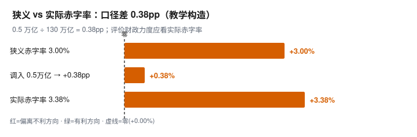

# 快读卡 · 财政领域 · 赤字率口径（构造示例）
> 结论层 [主卡](./fiscal.md) ｜ 审计底本 [附录](./fiscal_appendix.md) ｜ as-of 2026-10-04（虚构） · 教学构造 T4×1

🚨 构造示例：非真实发布数据，标 T4×1、as-of 构造日、补数项未检索（○），不可用于真实决策。

<!-- VISUAL:START -->
> “赤字率没提 = 财政没加力”是口径错误：狭义 3.0% 之外，调入与专项债等广义支出也要算，实际约 3.38%。

## 1 核心数字

| 指标 | 读数 | 对照 |
|---|---|---|
| 狭义赤字率 | 3.00% | 口径未变 · 不等于没加力 |
| 调入资金折算 | +0.38pp | GDP 130 万亿 · 0.5 万亿 |
| 实际赤字率 | 3.38% | 广义口径 · 高 0.38pp |

## 2 主图

| 分解项 | 数值 | 说明 |
|---|---|---|
| 狭义 → 实际 | +0.38pp | 调入资金折算，非新增风险 |

> 读图：0.38pp 是口径差（调入资金），不是四舍五入，也不是新增风险。

## 3 不能读成什么

⚠ 赤字率没提 ≠ 财政没加力：狭义口径漏掉调入、专项债等广义工具。

⚠ 专项债放量不等于形成投资：资金到位到实物工作量有 1—2 季时滞。

## 4 时效轴
| 时点 | 事件 | 性质 |
|---|---|---|
| 教学日 2026-10-04 | 构造示例发布，无真实发布方 | 发布 |
| 2026-10 下旬 | 9 月财政收支与专项债投向 | 下一步 |
| 待定 | 水泥 / 挖掘机 / 沥青开工，看资金落地 | 观察 |

## 5 下一步看什么
- 专项债资本金、政策性金融工具还有别的广义项 → 广义赤字上修。
- 水泥、挖掘机、沥青开工 1—2 季内同步回升 → “时滞”坐实，不是空转。

<!-- /VISUAL:END -->
**审计锚点**：判定 → [主卡](./fiscal.md) §2 ｜ 外源 → [附录](./fiscal_appendix.md) §K ｜ 图源 → 附录 §L ｜ 校验 B1–B5
**免责**：阈值未校准，不得当概率；不预测、非投资建议。

<!-- SYMBOLS:START -->
符号：§ 附录小节 ｜ T1–T4 信源分级 ｜ pp 百分点 ｜ ⚠ 误读 ｜ ○ 未检索
<!-- /SYMBOLS:END -->