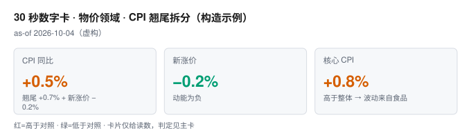
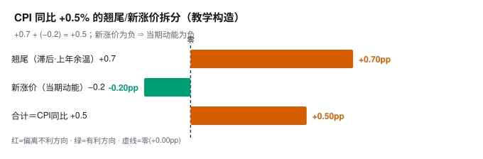

# 快读卡 · 物价领域 · CPI 翘尾拆分（构造示例）
> 结论层 [主卡](./prices.md) ｜ 审计底本 [附录](./prices_appendix.md) ｜ as-of 2026-10-04（虚构） · 教学构造 T4×1

🚨 构造示例：非真实发布数据，标 T4×1、as-of 构造日、补数项未检索（○），不可用于真实决策。

<!-- VISUAL:START -->
> “通胀起来了”是错的：+0.5% 里翘尾占 +0.7%，新涨价其实是 −0.2%——趋势没转，边际已在收缩。

## 1 核心数字

| 指标 | 读数 | 对照 |
|---|---|---|
| CPI 同比 | +0.5% | 翘尾 +0.7% + 新涨价 −0.2% |
| 新涨价 | −0.2% | 动能为负 |
| 核心 CPI | +0.8% | 高于整体 → 波动来自食品 |

## 2 主图

| 分解项 | 数值 | 说明 |
|---|---|---|
| 新涨价 | −0.2% | 翘尾 +0.7% 之下的当期动能 |

> 读图：看新涨价那一格为负：当期无新增涨价压力，涨幅全来自去年基数。

## 3 不能读成什么

⚠ “通胀起来了”是错的：新涨价已为负，边际在收缩。

⚠ 核心高于整体，说明波动来自食品，不是全面通胀。

## 4 时效轴
| 时点 | 事件 | 性质 |
|---|---|---|
| 教学日 2026-10-04 | 构造示例发布，无真实发布方 | 发布 |
| 2026-10 上旬 | 9 月 CPI 翘尾与新涨价 | 下一步 |
| 待定 | 中下游转嫁与需求 | 观察 |

## 5 下一步看什么
- 未来 3 个月新涨价转正且累计 ≥+0.3% → “边际收缩”被改写。
- 核心 CPI 连续 3 月 ≥+0.8% 且食品回落 → 扰动升级为趋势。

<!-- /VISUAL:END -->
**审计锚点**：判定 → [主卡](./prices.md) §2 ｜ 外源 → [附录](./prices_appendix.md) §K ｜ 图源 → 附录 §L ｜ 校验 B1–B5
**免责**：阈值未校准，不得当概率；不预测、非投资建议。

<!-- SYMBOLS:START -->
符号：§ 附录小节 ｜ T1–T4 信源分级 ｜ pp 百分点 ｜ ⚠ 误读 ｜ ○ 未检索
<!-- /SYMBOLS:END -->